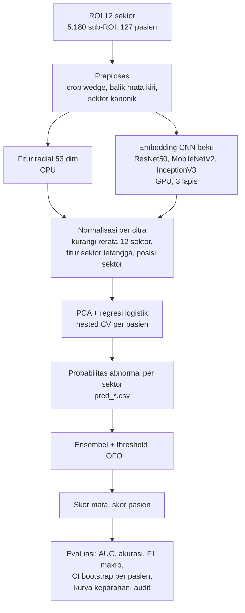

# Prediksi Kerusakan RNFL dari ROI Fundus 12 Sektor

Kode penelitian pendahuluan untuk mendeteksi kerusakan *retinal nerve fiber layer* (RNFL) dari ROI citra fundus yang terbagi menjadi 12 sektor, dengan label turunan laporan OCT. Pipeline akhir (v5) memakai fitur tekstur radial berbasis domain, embedding CNN beku, normalisasi per citra, regresi logistik teregularisasi, dan validasi per pasien.

> Hanya untuk penelitian. Kode ini bukan alat diagnosis. Data tidak disertakan.

---

## 1. Isi repositori

| Berkas | Fungsi | Status |
|---|---|---|
| `training_rnfl_v5_ring_kaggle.ipynb` / `.py` | **Pipeline akhir** (gunakan ini). Fitur radial + embedding + normalisasi per citra, nested CV, ensembel, tingkat mata dan pasien, kurva keparahan, audit | Utama |
| `sel_audit_salah_yakin.py` | Sel audit sektor salah-yakin (sudah termasuk di v5; berkas terpisah untuk dipakai ulang) | Pelengkap |
| `training_rnfl_v4_radial_kaggle.*` | Versi sebelum normalisasi per citra dan perbaikan pusat radial | Riwayat |
| `training_rnfl_v3_embedding_kaggle.*` | Embedding beku + regresi logistik (tanpa fitur radial) | Riwayat |
| `training_rnfl_v2_kaggle.*` | Fine-tuning CNN, tugas biner, tingkat mata | Riwayat |
| `training_rnfl_kaggle.*`, `training_rnfl_klasifikasi.ipynb` | Fine-tuning CNN 4 kelas (Kaggle dan Colab) | Riwayat |

File `.py` berisi isi yang sama dengan `.ipynb`; setiap sel dipisahkan oleh penanda `# %%`.

---

## 2. Data yang dibutuhkan

Dua berkas (unggah sebagai satu *Dataset* di Kaggle):

1. `label_sector_clean.csv` dengan kolom `file_name,label`. Satu baris per sub-ROI (5.180 baris), label bernilai 1–4.
2. `sector_clean.zip` berisi folder `sector/` dengan 5.180 gambar PNG.

Pola nama berkas gambar:

```
fff_0_111784_l_y_sector_5.png
 │   │  │      │ │     └── nomor sektor (0-11)
 │   │  │      │ └──────── nomor pemindaian
 │   │  │      └────────── sisi mata: l = kiri; r atau u = kanan
 │   │  └───────────────── id pasien
 └───┴──────────────────── awalan; pasien = fff_<n>_<id>
```

Ciri data yang dipakai kode:

- Setiap gambar adalah kanvas persegi (296–596 px, konstan dalam satu citra) berisi satu irisan annular pada posisi aslinya. Pusat kanvas = pusat optic disc.
- Sudut sektor k = 60° − 30°·k. Sektor 11 di atas, 5 di bawah, 2 di kanan.
- Mata kiri adalah bayangan cermin mata kanan: sektor kiri k dipetakan ke sektor kanonik (10 − k) mod 12, dan citranya dibalik horizontal.
- Satu pasien dapat memiliki hingga 96 sub-ROI (dua mata, pemindaian ulang). Karena itu semua pembagian data dilakukan **per pasien**.

---

## 3. Persyaratan

- Kaggle Notebook dengan **GPU T4** (GPU hanya dipakai untuk ekstraksi embedding).
- **Internet: On** (untuk mengunduh bobot ImageNet dari `storage.googleapis.com`; Kaggle meminta verifikasi telepon untuk mengaktifkannya).
- Pustaka (sudah tersedia di image Kaggle): `tensorflow`, `scikit-learn`, `numpy`, `pandas`, `scipy`, `joblib`, `pillow`, `matplotlib`.

---

## 4. Alur kerja



Ringkasan tahap:

1. **Praproses.** Gambar di-*crop* ke kotak pembatas irisan, mata kiri dibalik horizontal, lalu diubah ke 224 × 224 dengan *padding*.
2. **Fitur radial (53 dimensi).** Orientasi gradien relatif terhadap arah radial dari pusat disc, koherensi orientasi, gradien multi-skala (σ = 1, 2, 3), statistik warna, piksel pembuluh dikeluarkan.
3. **Embedding CNN.** Global average pooling dari tiga tahap tiap CNN: ResNet50 (3.584 dim), MobileNetV2 (2.048 dim), InceptionV3 (3.104 dim). Bobot ImageNet dibekukan.
4. **Normalisasi per citra dan konteks.** Setiap fitur dikurangi rerata 12 sektor pada citra yang sama (tanpa label), ditambah rerata fitur dua sektor bertetangga dan posisi sektor kanonik (one-hot).
5. **Klasifikator.** Regresi logistik berbobot kelas seimbang. Untuk model berembedding, embedding distandarisasi lalu direduksi PCA (32/64/128 komponen) dan digabung dengan fitur radial. Hiperparameter dipilih lewat *nested CV* per pasien (kriteria AUC).
6. **Validasi.** 5-fold StratifiedGroupKFold dengan pasien sebagai grup (`SEED = 42`, pembagian fold sama untuk semua model).
7. **Threshold.** Dipilih memaksimalkan F1 makro pada fold *lain* (leave-one-fold-out, LOFO).
8. **Agregasi.** Skor citra = 12 × rerata probabilitas abnormal 12 sektor; skor mata = rerata atas citra pada mata yang sama; skor pasien = maksimum atas matanya.
9. **Pelaporan.** CI 95% *bootstrap* per pasien, kurva keparahan (mata dan pasien), dan audit sektor salah-yakin.

Model yang dibandingkan: `ResNet50`, `MobileNetV2`, `InceptionV3` (embedding + fitur radial + normalisasi), `RADIAL` (fitur radial saja, tanpa embedding dan PCA), dan `ENSEMBLE` (rata-rata probabilitas keempatnya, bukan model terpisah).

---

## 5. Cara menjalankan (Kaggle)

1. **Unggah dataset.** *Datasets → New Dataset*, unggah `sector_clean.zip` dan `label_sector_clean.csv` (private).
2. **Buat notebook.** *New Notebook → File → Import Notebook*, pilih `training_rnfl_v5_ring_kaggle.ipynb`. Klik *Add Input* dan pilih dataset tadi.
3. **Atur Settings.** Accelerator **GPU T4 x2** (hanya satu GPU yang dipakai) dan **Internet On**.
4. **Jalankan** semua sel dari atas (*Run All*). Untuk berjalan di latar belakang, gunakan *Save Version → Save & Run All (Commit)*.
5. **Ambil hasil** dari folder `/kaggle/working/hasil_training/` (tab *Output* pada versi yang di-commit).

Lokasi data dicari otomatis di `/kaggle/input` (nama dataset dan folder bebas). Jika CSV tidak ditemukan, kode mencetak isi `/kaggle/input` lalu berhenti dengan pesan jelas.

### Melanjutkan sesi
Embedding dan fitur radial disimpan (`emb_*.npy`). Untuk memakainya ulang pada versi baru, lampirkan output versi sebelumnya sebagai *Input* (*Add Input → Notebook Output Files*); kode menyalinnya otomatis sehingga ekstraksi GPU dilewati.

### Pemeriksaan kewarasan (sanity check)
Setelah sel-sel awal, pastikan keluaran berikut cocok:

- `Gambar: ... -> 5180 file`
- `Jumlah pasien: 127 | baris: 5180`
- `Tingkat mata: 235 mata, 433 citra`
- Fitur radial `(5180, 53)`; embedding `(5180, 3584)`, `(5180, 2048)`, `(5180, 3104)`.

---

## 6. Peta sel notebook v5

| Sel | Isi | Keluaran |
|---|---|---|
| 1 | Impor, konstanta nama berkas dan folder | — |
| 2 | Mencari CSV dan gambar di `/kaggle/input`, menyalin `emb_*.npy` lama | — |
| 3 | Inspeksi CSV | tabel awal |
| 4 | **Konfigurasi** | — |
| 5 | Persiapan data: grup pasien, sisi mata, sektor kanonik, label | statistik data |
| 6 | Verifikasi visual rekonstruksi cincin ROI | gambar |
| 7 | Fitur radial v2 (CPU) | `emb_radial_feats_v2.npy` |
| 8 | Ekstraksi embedding (GPU) | `emb_<arch>_224.npy` |
| 9 | Nested CV per pasien | `pred_<tag>_emb_<model>_fold<k>.csv` |
| 10 | Analisis: ensembel, LOFO, tingkat mata | `analisis_sektor_<tag>.csv`, `analisis_mata_<tag>.csv` |
| 11 | Laporan target (hanya pelaporan) | teks |
| 12 | CI 95% akurasi dan F1 makro | teks |
| 13 | Kurva keparahan tingkat mata | `kurva_keparahan_<tag>.csv` |
| 14 | Kurva keparahan tingkat pasien | `kurva_keparahan_pasien_<tag>.csv` |
| 15 | Audit sektor salah-yakin | `audit_salah_yakin.csv`, `audit_salah_yakin.png` |

`<tag>` = `binary_emb224` (dari `RUN_TAG`).

Format `pred_*.csv`: `p0, p1, file_name, y, fold, arch, scenario` (`p1` = probabilitas abnormal; prediksi *out-of-fold*).

---

## 7. Parameter penting (sel 4)

| Parameter | Nilai bawaan | Arti |
|---|---|---|
| `TASK` | `'binary'` | `'binary'` (normal vs abnormal) atau `'multiclass4'`. Sel 13–15 mengasumsikan `'binary'` |
| `BINARY_NORMAL_CLASSES` | `[1]` | Label yang dianggap normal. **Asumsi; konfirmasi dengan laporan OCT** |
| `EYE_ABNORMAL_MIN` | `3` | Mata abnormal bila ≥ K sektor abnormal. Bukan batas klinis; tentukan bersama dokter |
| `TARGET` | `0.88` | Hanya untuk pelaporan; tidak dipakai memilih model atau hiperparameter |
| `EMB_SIZE` | `(224, 224)` | Ukuran masukan ekstraksi embedding |
| `BACKBONES` | ResNet50, MobileNetV2, InceptionV3 | CNN pra-latih ImageNet |
| `USE_SELFNORM` | `True` | Normalisasi per citra dan fitur tetangga |
| `USE_RADIAL` | `True` | Menggabungkan fitur radial ke model embedding (`RADIAL` selalu memakainya) |
| `PARAM_GRID` | PCA {32, 64, 128}; C {0,003 … 0,3} | Grid dalam *nested CV* |
| `N_FOLDS`, `SEED` | `5`, `42` | Validasi per pasien |
| `K0`, `T_LIST` | `1`, `[3, 4, 6, 8]` | Sel keparahan: normal ≤ K0 vs parah ≥ T. **Tetapkan sebelum melihat hasil** |

---

## 8. Membaca hasil

- **Selang kepercayaan [a; b].** Rentang 95% dari *bootstrap per pasien* (pasien diambil ulang dengan pengembalian, 500 replikasi untuk AUC dan 1.000 untuk akurasi/F1). Jika rentang dua model tumpang tindih, perbedaannya belum dapat dianggap nyata.
- **AUC.** Tidak bergantung pada threshold; lebih stabil daripada akurasi dan F1 pada sampel kecil.
- **Akurasi dan F1 pada threshold LOFO.** Threshold dipilih pada fold lain. Pada n kecil (mis. 31 dan 48 pasien), satu pasien menggeser akurasi sekitar 1,3 poin.
- **Skor mata dan pasien.** Dibangun dari prediksi sektor; label mata dan pasien diturunkan dari label sektor dengan aturan K dan T, sehingga ini bukan diagnosis klinis.
- **Kurva keparahan.** Desain kasus-kontrol (kasus ringan sampai sedang dikeluarkan) yang mengandung *spectrum bias*; angkanya tidak setara dengan kinerja skrining populasi.

---

## 9. Prinsip evaluasi (jangan dilanggar)

1. Pembagian data **per pasien** pada semua tahap. Pembagian acak per citra membocorkan data (pada baseline awal menaikkan F1 makro dari 0,36 menjadi 0,57 tanpa perbaikan model).
2. Hiperparameter hanya dipilih pada data latih (inner CV); threshold hanya pada fold lain.
3. Oversampling (jika dipakai) hanya pada data latih; data validasi dan tes tetap berdistribusi asli.
4. Parameter analisis (`K`, `K0`, `T_LIST`, agregator) ditetapkan sebelum melihat hasil dan **semua** nilai dilaporkan, bukan yang terbaik saja.
5. Jangan menyetel ulang sampai angka mencapai target. Bila ingin menyetel lebih lanjut, sisihkan *hold-out* pasien terkunci dan evaluasi satu kali.
6. Angka dalam naskah harus berasal langsung dari berkas keluaran (`analisis_*.csv`, `kurva_keparahan_*.csv`), bukan diketik atau diubah manual.

---

## 10. Pemecahan masalah

| Gejala | Penyebab dan solusi |
|---|---|
| `FileNotFoundError: label_sector_clean.csv tidak ditemukan` | Dataset belum ditambahkan lewat *Add Input*. Kode mencetak isi `/kaggle/input` untuk dicek |
| Gagal mengunduh bobot ImageNet | Internet belum On, atau akun belum terverifikasi telepon |
| `list_physical_devices('GPU')` kosong | Accelerator belum GPU; ekstraksi embedding akan sangat lambat |
| `layer tidak ditemukan, dilewati: ...` | Nama layer menengah berbeda pada versi Keras Anda; kode memakai tahap yang tersisa (dimensi embedding akan berubah) |
| `File hilang: N dari 5180` | Gambar tidak lengkap atau path salah |
| Memori habis saat PCA | Turunkan grid `n_components` atau jalankan satu backbone per sesi |
| Embedding lama tidak terpakai | Output sesi sebelumnya belum dilampirkan sebagai *Input*, atau nama berkas `emb_<arch>_<ukuran>.npy` berbeda dengan `EMB_SIZE` saat ini |
| Sel 13–15 error pada `multiclass4` | Sel tersebut memakai `p1` (probabilitas abnormal); gunakan `TASK = 'binary'` |

---

## 11. Asumsi dan keterbatasan yang perlu diketahui

- Arti label 1–4 dan anggapan kategori 1 = normal belum dikonfirmasi dari laporan OCT.
- Hanya 127 pasien dan ROI 12 sektor; citra fundus utuh tidak tersedia.
- Registrasi label OCT–fundus tidak sempurna (wedge dari pemindaian berbeda pada mata dan sektor yang sama hanya berkorelasi sekitar 0,71); audit label oleh klinisi belum dilakukan (gunakan sel 15).
- Tidak ada *hold-out* terkunci atau validasi eksternal; pengembangan dan evaluasi memakai fold yang sama, sehingga estimasi dapat sedikit optimistis.
- Parameter fitur (σ = 1, 2, 3; 8 *bin*; ambang pembuluh −1,2 SD) ditetapkan berdasarkan pertimbangan, tidak dioptimalkan ekstensif.
- Kode diuji bagian non-TensorFlow-nya secara terpisah; ekstraksi embedding dijalankan di Kaggle (GPU T4).

---

## 12. Menjalankan di luar Kaggle

Ubah `INPUT_ROOT` (folder berisi CSV dan gambar atau zip) dan `OUT_DIR` pada sel 1, serta pastikan TensorFlow dengan GPU terpasang. Fungsi `display(...)` bersifat Jupyter; pada skrip biasa ganti dengan `print`. Jalur lokal belum diuji.

---

## 13. Sitasi dan lisensi

Cantumkan sitasi naskah dan lisensi yang sesuai di sini sebelum repositori dipublikasikan: `[lengkapi]`.
